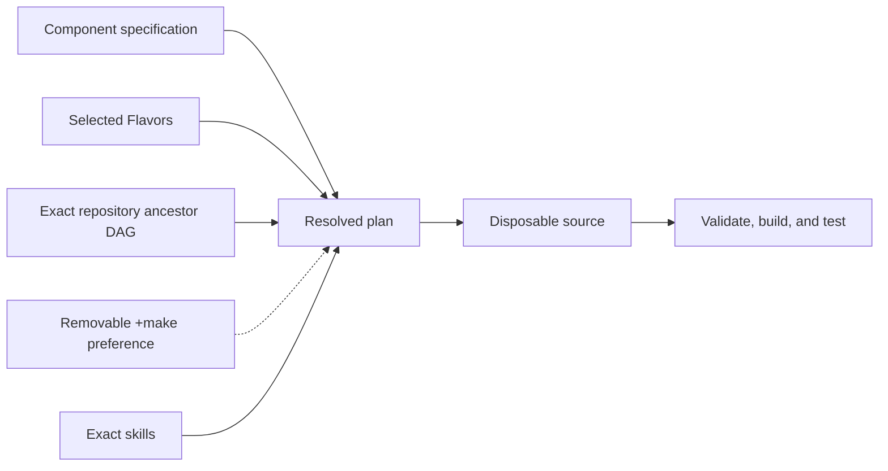

# Agentic Distributed Harness Depot (ADHD)

Project guide

Contributors follow the [documentation consistency policy](user/documentation-policy.md)
when changing behavior, configuration, interfaces or deployment.

ADHD is an A2A information hub for agents that need to exchange messages without
direct connectivity, publish information, and query or search shared information.
Agents subscribe to raw project events, optionally narrowing them with exact
metadata selectors or a plain-text semantic filter. Kafka transports profile-2
events; durable A2A queues remain the agent interface. Models are optional.

The first Elixir hub prototype supports authenticated A2A commands, durable queues,
and Nemotron-backed subscriptions. The root `PROJECT.md` records its scope and
remaining decisions; this is a local prototype without a standalone installer.

Start with [getting started](user/getting-started.md) for installation and usage.
For a running MVP, use the [live-testing checklist](user/live-testing.md).
See the [user guide](user/using-the-hub.md) to connect an agent, the
[admin guide](admin/operations.md) for container deployment and recovery, and
[troubleshooting](admin/troubleshooting.md) to diagnose failures.
The [hub API](user/hub-api.md) describes commands and a two-agent workflow.
The [OpenRig integration](user/openrig.md) covers pinned CLI compatibility,
private seat/project bindings and the provider-neutral A2A adapter.
The [stored-information guide](user/stored-information.md) covers message/status
history, source provenance, ID retrieval, filtered search, and future connectors.
The [contextual-record guide](user/contextual-records.md) describes original
statements, immutable corrections and frozen public evidence snapshots.
The [history-query guide](user/history-queries.md) covers durable local archive
questions, original citations, budgets and coverage.
The [candidate retrieval guide](user/retrieval.md) explains bounded contextual
search, original provenance and rebuildable indexes.
Agents can follow `skills/agent/coordinate-via-hub/SKILL.md`
to subscribe and catch up at startup, publish and poll during work, and process
and acknowledge received updates.
See [active work](roadmap/active-work.md) for current development status.
The completed [multiple-project roadmap](roadmap/multi-project.md) records the
transition to isolated projects, including access, migration, federation, hot
Admin controls and qualification. The completed [Kafka pub/sub roadmap](roadmap/kafka-pubsub.md)
records per-server Kafka behind A2A, optional plain-text filters, independent
backend fact search and Compose/Kubernetes deployment. Their
[qualified implementation](../verification/ownedMULTI008/source41-final-composition-after-full25/review.json)
retains exact runtime evidence and operating limits separately from older profile-1 results. See the [protocol profile](protocol/multi-eventing.md)
and [native federation/control evidence](verification/federation-controls.md).
The [project recovery checks](verification/project-recovery.md) distinguish pure
backup validation from stopped-server portable rebind and crash recovery proofs.
The [Kafka service operations guide](admin/event-service.md) covers the new
Compose/Kubernetes packages and their current qualification boundaries.
The [adaptive retrieval roadmap](roadmap/adaptive-retrieval.md) records the planned
context storage, semantic scans, search-then-scan and evidence-driven index workflows.
See [federated project discovery](user/federation.md) for the opt-in asynchronous
peer workflow and [FED-001](roadmap/active-work.md#fed-001--federate-project-hubs-for-asynchronous-discovery)
for implementation and acceptance status.
See [model and A2A integration](architecture/model-integration.md) for the initial
decision model, test peer, and serving prerequisites.

## Development

This project is built with [Literate AI](https://github.com/jordanhubbard/literate-ai).
The default implementation language is Elixir (Elixir 1.18+ with Erlang/OTP 27+),
using Make on Linux. The macOS Flavor remains available for macOS builds.
Python-only pip packaging is not selected by default.
The [framework flow](user/framework-flow.md) explains the specification-led lifecycle,
and the [project map](user/project-layout.md) identifies the authority for a change.

See [readable specifications](user/specifications.md),
[models and generation](user/models-and-generation.md),
[private test matrices](user/test-matrix.md),
[security](user/security.md), [skill boundaries](architecture/skills.md), and the
[authority learning loop](architecture/authority-learning-loop.md), the
[mission-specification map](architecture/mission-specification-composition.md), and the
[traceability rule](architecture/design-traceability.md) when those concerns apply.

Initialize from an organization or product repository with
`litai init PATH --from URL[#REVISION]`. Literate AI resolves every ancestor without
executing repository code, then records exact commits and inherited catalog provenance.
Use `litai update` to re-resolve that chain and `litai reparent URL|none` to review an
explicit parent change.

The [web management console](admin/web-console.md) provides authenticated health, information,
subscription and delivery observation, plus confirmed subscription management and
pending-job retries. It uses a separate administrator credential.

The [managed HTTPS guide](admin/acme.md) describes ACME setup, hot Admin controls,
private certificate state and the current qualification boundary.

The [local model service](admin/model-service.md) runs the selected decision model
in a pinned GPU container alongside the hub.

[Wire protocol versions, schemas and conformance](protocol/README.md) document the
agent, peer, browser/admin, OIDC and decision-model interfaces.

See [source ownership and federated identities](user/federation-directory.md)
for canonical catalogs, scoped questions and identity matching.

The [archive question guide](user/archive-queries.md) explains original-evidence
assessment, full-scan fallback, stage budgets and sampled audits.

The [retrieval replay guide](user/retrieval-replay.md) covers captured attempts,
independent Admin labels, cohort/exposure controls and actual paired recipe costs.
