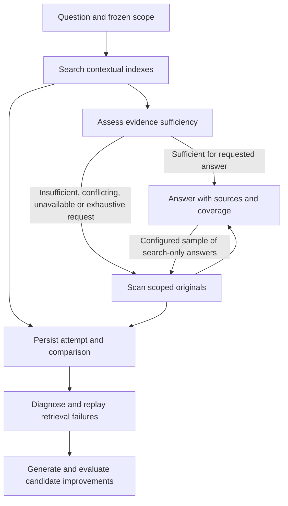

# Contextual information and adaptive retrieval

- **Status:** active
- **Owning queue item:** [INFO-002](active-work.md#info-002-preserve-contextual-evidence-without-a-domain-taxonomy)
- **Completion / archival evidence:** pending while INFO-002 and the dependent QUERY-001, SEARCH-001, SEARCH-002, SEARCH-003 and INDEX-001 requests remain open

## Intent and current boundary

Store what agents actually say, together with the context needed to interpret it.
New questions must not require new ingestion schemas, domain categories or indexes
predicted by the user. Interpretations and indexes are replaceable derivatives of
the evidence, not substitutes for it. Choosing a general retrieval mechanism does
not imply anticipating every future question.

INFO-001 already supplies immutable publications, arbitrary text/JSON, source
provenance, event/ingestion times and durable ID retrieval. Current search is literal
substring matching; subscription relevance applies to future publications. This
document specifies requested future work, not available commands or implemented
runtime behavior. The existing Component contract remains the current API authority.

The program belongs to the hub Component. Its implementation must flow through
Component specifications and Literate AI generation/acceptance. It does not require
a framework change, a domain ontology, a knowledge graph, a particular embedding
provider or a replacement for DETS. Any new dependency or storage migration must
be justified and specified in its owning request, including deployment and rollback.
The current standard-runtime-only constraint must be explicitly reconciled before
introducing a database extension or nonstandard library.

## Delivery order

| Request | Deliverable | Prerequisite |
| --- | --- | --- |
| INFO-002 | Contextual records and immutable evidence links | INFO-001 |
| QUERY-001 | Semantic scan evaluator and durable query jobs | INFO-002 |
| SEARCH-001 | General-purpose contextual retrieval and rebuildable indexes | INFO-002 |
| SEARCH-002 | Search-then-scan policy and sampled audits | QUERY-001, SEARCH-001 |
| SEARCH-003 | Attempt history, failure analysis and replay | SEARCH-002 |
| INDEX-001 | Evidence-driven candidate generation and promotion | SEARCH-003 |

Build the scan path first so that indexes remain optional accelerators. Each request
has its own unchecked implementation and acceptance gates in the active queue.
INFO-002 owns this shared design; completing that request alone does not complete
the program. Next action: specify its context envelope and legacy-store fixtures.

## Contextual records

Preserve original text and arbitrary JSON alongside the authenticated submitter,
claimed source, occurrence time and ingestion time. Context can identify the
question answered, subject, conversation, task, reply, supporting publication or
correction. These are communication relationships, not prescribed domain facts.
Existing clients without context must remain valid.

For example, retain all three answers to “Is there a bird in that tree?” verbatim:
“Yes”, “I see a cardinal in that tree”, and “There is a red bird on the branch”.
Bind the question and tree referent to the observations. Do not replace them with
`bird_present: true`. Preserve “Actually, that was a leaf” as a subsequent assertion
linked to its target; do not silently delete the earlier report or assume the
latest statement is necessarily correct.

Context references must resolve only within the caller's authorized evidence scope.
Private addressed messages remain excluded from project-public retrieval, scans,
indexes and feedback. An inaccessible reference must not reveal private content.
Define bounded traversal, cycle handling and explicit missing-context outcomes.
External URLs alone cannot reconstruct changing evidence: retain an authorized
snapshot or immutable content identity when available, otherwise state the gap.

Query and index manifests bind the publication and context versions actually used.
Later replies/corrections invalidate affected derived context without mutating old
evidence. Preserve complete originals even when indexing uses smaller chunks.

## Semantic scans

Accept a natural-language question plus an authorized scope and execution budget.
Freeze corpus membership at a durable ingestion watermark; distinguish event-time
filters from ingestion time. Later-arriving publications belong to a later query.
Context expansion must also respect the snapshot and visibility boundary.

A scan evaluates the entire selected corpus, in bounded batches, and can combine
linked observations during synthesis. Independent per-message classification alone
must not exclude evidence that is useful only jointly. Retain record coverage,
context gaps, evaluated batches and continuation checkpoints. Long inference runs
as durable jobs outside the synchronous request path and store writer. Specify
submission, status, continuation, cancellation and result retrieval in the A2A
contract before generating code; this plan does not invent callable operations.

Answers include source IDs and supporting excerpts or spans, contradictions,
interpretation provenance, and uncertainty. Absence of evidence is not falsehood.
Three reports do not imply three independent observations or three distinct birds.
An answer about explicitly reported color must distinguish explicit wording from
background inference about the color of a cardinal.

Report execution state separately from semantic outcome: a complete scan can find
no support or conflicting evidence; a cancelled, failed or budget-limited scan is
partial. Full corpus coverage is not a guarantee of correct model interpretation.
Persist evaluator/prompt versions and distinguish extraction from synthesis. The
existing typed subscription-relevance adapter is not assumed to support either.

## General-purpose retrieval

Use common text and semantic retrieval mechanisms across contextual records, with
exact scope filters and link expansion where useful. Embed “Yes” with its question
and referent rather than in isolation. Fetch originals before evaluating support.
Similarity is candidate selection: a negated statement can be a close neighbor.

Each derived index has a recipe/version, model identity where applicable, source
and context identities, build state and indexed-through watermark. Ingestion must
succeed durably even if indexing is unavailable. Index work is asynchronous,
retryable and restartable; context changes schedule affected updates. Rebuilds
read authoritative records and expose their coverage. An index must never be the
only retained copy of a publication or context.

Retain the existing literal search behavior. Introduce semantic retrieval through
an explicit compatible extension, with documented ranking, limits and coverage.
No candidate limit or similarity threshold establishes semantic exhaustiveness.

## Search-then-scan

Expose search-only, scan and search-then-scan execution policies. Use a versioned
sufficiency policy that evaluates whether evidence supports the actual question;
nonempty results and high similarity alone do not suffice. Record escalation
reasons, configured budgets and actual execution path. Exhaustive count/all queries
require full applicable-scope evaluation or independently validated equivalent
coverage; a top-k result cannot silently stand in for that evaluation.

Escalate for missing support, unresolved contradictions, stale/incomplete indexes
or retrieval failure. A failed evaluator is an error, not a nonmatch. If scan
resources run out, return explicit partial coverage and a continuation option.
Any cached judgment is keyed by question, scope/snapshot, policy and evaluator
identity, with invalidation on changed evidence or context.

Occasionally audit apparently successful searches with scans to discover confident
but incomplete results. Configure sampling and resource caps; record selection
probability and report audited versus fallback-only populations separately.

## Failure analysis and replay

Retain durable query-attempt records containing the question, authorized scope and
snapshot, index/evaluator/policy versions, search candidates/ranks, scan coverage,
useful missed evidence, changed answers, failure reasons, latency and work cost.
These are operational evidence, access-controlled separately from publications;
do not feed generated answers back into ordinary search as independent facts or
emit subscription deliveries for internal feedback.

Classify outcomes before proposing improvements:

- Search missed evidence that a completed scan found: retrieval failure.
- Neither path found evidence: possible archive gap, subject to evaluator quality.
- Scan was partial or evaluator failed: insufficient comparison evidence.
- Search found evidence but interpreted it incorrectly: interpretation failure.
- A scan audit changes a plausible answer: hidden retrieval or interpretation miss.

Cluster recurring failures without requiring a predeclared subject taxonomy.
Re-evaluate past failed searches after retrieval changes. Compare versions against
the same frozen corpus; distinguish a new answer caused by new publications from
one caused by improved retrieval. Include successful searches and no-evidence cases
to detect regressions. Model scan judgments are provisional labels; use independent
fixtures and adjudication for consequential or disputed evaluation cases.

## Index generation and promotion

Repeated fallbacks are diagnostic evidence, not an instruction to always create
another index. Test context assembly, chunking, ranking, filters and link traversal
as possible causes. Define configurable recurrence/support thresholds and minimum
evaluation evidence rather than inventing a universal fallback count.

The workflow is: observe misses, diagnose, propose a versioned recipe, build an
isolated candidate, replay, qualify, catch up, promote, monitor and retire or roll
back. Initial generated recipes must be declarative selections of supported
retrieval capabilities; stored text and model output must not become arbitrary
executable database commands or code. Runtime capability additions use normal
Component specification and generated-code acceptance workflows.

Bind candidates to source snapshots and failure examples. Separate proposal/tuning
examples from held-out evaluation and a regression cohort. Measure missed-evidence
recovery, successful-query regressions, fallback rate, answer support, latency,
inference cost, index size and rebuild cost. Record sample sizes and incomplete
evaluations. Promotion criteria and resource budgets must be explicit configuration;
lower fallback rate alone is not a quality measure.

Candidate jobs persist checkpoints and cannot block ingestion or delivery. Catch
up publications and context changes before an atomic active-version switch. Keep
the prior usable version for rollback and recheck quality after promotion. Bound
candidate counts, retries and rebuild frequency to prevent runaway or repeated
ineffective optimization. Retire derived artifacts without deleting source evidence.
Allow operator-configured automatic promotion when gates pass or a review-based
mode; this choice is policy, not a mandatory approval for every future index.

## Shared acceptance and outstanding implementation choices

All six requests preserve authentication, private-message isolation, publication
identity, source retry deduplication, subscription behavior and restart durability.
Independent acceptance includes the bird examples, negation, corrections, jointly
useful records, exact identifiers, absent evidence, hidden search misses, interrupted
scans/builds, concurrent writes, index replacement and rollback. Evaluate model
quality with labeled fixtures and actual configured services, not only stubs.

Implementation must select the precise context wire shape, query-job API, evaluator
and retrieval adapters, budgeting defaults, audit sampling and promotion thresholds
from measured workloads. Record those choices in owning Component contracts; do
not force users to anticipate domain indexes. Documentation, SDK, container and
management visibility changes travel with the relevant request. No runtime
completion, model selection or production quality guarantee is claimed here.
