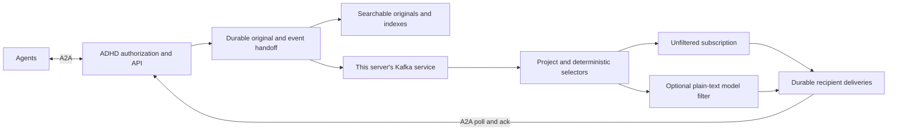

# Kafka pub/sub with optional semantic filtering

- **Status:** active
- **Owning queue item:** [KAFKA-001](active-work.md#kafka-001-specify-kafka-eventing-and-optional-subscription-filters)
- **Completion / archival evidence:** pending while KAFKA-001 through KAFKA-009 remain open

## Direction and implementation boundary

Pivot project event distribution to Apache Kafka. Each logical ADHD server has
its own Kafka service serving its local projects. Agents continue to communicate
with ADHD through A2A and need neither Kafka credentials nor a Kafka client.
A subscription may receive all authorized project events across all agents,
or narrow that stream using an optional plain-text Jev-like model filter.
Backend facts remain searchable independently of subscriptions. Models may support
semantic search and optional filtering; raw pub/sub must work without a model.

This is an active planning program, not an implemented transport. Current
Component contracts and accepted artifacts still implement model-matched
subscriptions over local durable queues. Existing closed work retains its
historical evidence. KAFKA-001 must author replacement normative contracts before
generation, including removal of the current standard-runtime-only constraint
where a supported Kafka client requires dependencies. No Kafka/client version,
image, Kubernetes operator or chart is selected by this roadmap.

The pivot composes with [multiple projects per server](multi-project.md). Kafka
is per server, not per project or per agent. A Kafka service can be one development
broker or a replicated deployment; resilience claims depend on the selected
topology. Federation remains an authenticated ADHD-to-ADHD protocol. Private
brokers are not exposed to agents or peers, and broker mirroring is not selected
as a federation transport. Canonical ownership and export authorization still
apply before any remote information is disclosed. A future cross-server event
subscription bridge needs its own exact contract; this program does not silently
replicate every local project into peer brokers.

## Proposed flow and subscription contract

This is a logical separation, not a claim that Kafka and the backend share a
transaction. KAFKA-001/002 must specify the authoritative commit point and durable
handoff, such as a backend transaction with an outbox and idempotent publication.
The backend retains originals; Kafka carries project events; ADHD retains
subscription identity, delivery/ack state and retry/deduplication authority.

| Mode | Meaning | Model requirement |
| --- | --- | --- |
| Project stream | All project-published events, across all agents, including the subscriber's own publications. | None; no inference calls. |
| Deterministic selection | Optional explicit event type/source/publisher selectors within the admitted project. | None; ordinary exact selection. |
| Semantic filter | Plain-text criterion applied after project/metadata selection to narrow the stream. | Configured short-response decision adapter. |

Published project information is the initial event stream. Private addressed
messages, passwords, tokens, role changes and internal control records are not
project-public events. Direct messages retain their authorized A2A delivery path;
any broker use for them must have separately specified private storage and ACLs.
All events still require project admission, owner checks and current export policy.
A model chooses relevance, never permissions.

Subscription schemas must distinguish an absent filter from invalid/blank filter
text and preserve old described subscriptions as filtered mode. New unfiltered
subscriptions require no dummy description or model endpoint. For example, an
agent can subscribe to every event in project P, then optionally add “Only API
compatibility changes or blocked releases.” The exact wire fields belong to the
normative contract phase rather than this illustrative prose.

Define the activation watermark atomically relative to publication acceptance.
Preserve the existing default of new events only; historical replay is explicit,
bounded and authorized. Specify pause/resume and filter edits as revisions with
an exact effective watermark. Pending evaluations use a documented revision;
late decisions cannot silently apply a new predicate to an old job. Define
overlapping subscriptions using the existing one-logical-delivery-per-recipient
publication behavior where compatible, with subscription reasons/provenance.
Raw deliveries must not invent model scores, thresholds or model names.

If a model is absent, reject or explicitly pause new semantic-filter requests
with a documented state. If it fails after acceptance, preserve pending work and
expose retry/error status. Never turn an outage into a negative match or silently
drop the filter and disclose all events. Bound filter backlog/costs independently
so raw subscriptions and other projects continue making progress.

## Delivery, ordering and retention decisions

Kafka consumer-group load sharing is different from giving every subscriber its
own complete stream. Choose a bounded ADHD fan-out design with durable per-agent
subscription state; do not put unrelated agent subscribers into one shared worker
group and accidentally divide their events. Decide topic/group cardinality and
cleanup from project/subscription scale, rather than creating a topic per agent
by default.

Specify event ID, stable server/project identity, publisher/source provenance,
schema version, timestamps, topic key, partitioning and size bounds. Record the
ordering promise: partition ordering does not itself establish project-wide or
cross-project order. Preserve existing A2A delivery ordering where promised,
or document a reviewed versioned change. Define poison-message isolation,
retry limits, dead-letter review and authorized replay without treating a failed
record as successfully delivered.

Distinguish these durable positions explicitly:

1. Original accepted and retry identity committed.
2. Event handed off to Kafka with known durability settings.
3. Event materialized into subscription/filter work and recipient deliveries.
4. Backend/search projection caught up to an exposed watermark.
5. Recipient acknowledges a delivery through A2A.

Commit broker processing progress only after recoverable downstream work exists.
Broker progress is not the agent acknowledgement. Agent polls do not consume or
acknowledge records; repeat delivery remains possible. Define out-of-order/batch
acks without advancing a cursor past unacknowledged records. Process crashes,
rebalances and duplicate publications must retain one logical original/delivery
using stable IDs and deduplication, without claiming exactly-once network receipt.

Kafka transactions cover Kafka records and consumer offsets; external backend
writes and A2A receipts need their own coordination. This boundary follows
[Apache Kafka's delivery/transaction design](https://kafka.apache.org/41/design/design/).
That reference informs the plan; it is not a selected deployment version.

Broker retention must never silently discard accepted unacknowledged deliveries
or original facts. Specify durable delivery materialization/spooling and bounded
admission/backpressure for disconnected agents and long filter outages. If a
consumer loses retained offsets, expose an explicit gap and define recovery from
durable originals or an operator-controlled replay; never reset to latest and
claim complete delivery. Define time/size retention, compaction eligibility,
deduplication lifetime and restore behavior together.

## Search and model independence

Store originals/provenance regardless of subscription presence or filter outcome.
Kafka retention is an event-transport policy, not the fact-history retention
policy. Literal/metadata search and ID retrieval continue without a model.
Semantic retrieval, history/archive answers, replay and optimizer workflows can
use configured models, with explicit capability, unavailable/error and coverage
states. Their failure must not make basic eventing unavailable.

Define read-after-publish behavior and expose projection/index watermarks and lag.
A lagging index is not evidence that a fact does not exist. Preserve originals,
citations, corrections, authorization and project isolation during catch-up,
rebuild and replay. Pub/sub semantic filters are separate from search-time model
work and retain separate queues, budgets and metrics.

## Admin, deployment and migration

Provide hot, role-scoped Admin forms for broker connection/security references,
topic/retention policy, raw/filtered subscription modes, filter thresholds,
model enablement, backlog/lag, recovery and replay controls. Retain exactly one
server role plus MULTI project admission. Apply revisioned configuration with
consumer fencing, cutover watermarks and secret redaction. Connection changes
must not reset offsets or replay a whole topic implicitly.

Configuration-file location remains the only setting requiring a hub restart.
Kafka infrastructure may require broker/controller rollouts for broker-owned
static settings; document them separately and orchestrate them without requiring
a hub restart. Expose supported app-managed settings in Admin; arbitrary cluster
administration, image upgrades and volume provisioning belong to deployment
tooling rather than unrestricted shell or Kubernetes access from the hub.

Ship both a Docker Compose application and a Kubernetes application. Each includes
the hub, private Kafka/KRaft service, persistent broker and backend volumes,
secret handling, resource limits and health/ready probes. A model-free baseline
must boot successfully with no GPU; an optional model profile uses the existing
decision service or a configured endpoint. Select pinned broker/client artifacts,
licenses and supported compatibility ranges during implementation. Decide plain
manifests versus a maintained chart/operator explicitly. K8s packaging does not
authorize multiple hub replicas against the current single-writer store: retain
one replica until a separate concurrency/HA contract is qualified.

Document startup/shutdown dependency behavior, unavailable broker admission,
backpressure, metrics, backups, volume restore, replacement and broker upgrades.
Distinguish single-node development durability from replicated Kafka durability.
Test broker and hub recovery independently and in combination.

Coordinate one migration with MULTI-002: preserve prior project identity, users,
agent credentials, originals, descriptions/filters, pending model jobs, delivery
IDs and acknowledgements. Define outbox initialization and cutover watermarks
without replaying all historical originals into new subscriptions. Specify
migration order for current single-project and already multi-project stores,
backups of both durable domains, repeatable crash recovery and downgrade limits.
Old semantic subscriptions must not silently become unfiltered subscriptions.

## Work and acceptance order

Implement this program in four reviewable groups, together with the corresponding
MULTI work. Contract review precedes code that changes agent-visible behavior;
packaging can proceed once the broker boundary is defined.

1. **Contracts and infrastructure:** KAFKA-001/002/007 define the event and
   subscription schemas, durable handoff, broker integration and both deployment
   packages. Establish the model-free startup path first.
2. **Agent streams and optional filtering:** KAFKA-003/004 add independent A2A
   subscriptions, polling/acknowledgement and isolated semantic-filter work.
   Demonstrate all-agent project fan-out without inference before adding filters.
3. **Facts and administration:** KAFKA-005/006 preserve backend search and add hot
   Admin configuration, diagnostics and safe connection/filter changes. A rejected
   filter decision must never remove the original from searchable history.
4. **Upgrade and qualification:** KAFKA-008/009 prove migration, recovery and
   interoperability on the exact combined multi-project artifact in Compose and
   Kubernetes before closing the program.

The minimum end-to-end demonstration uses agents A and B publishing in project P
and two independent subscribers. One subscribes to every P event; the other adds
the plain-text criterion “API compatibility changes.” Both publishers' events
reach the raw subscriber with zero model calls; only matching events reach the
filtered subscriber. With the model disabled, raw delivery and literal fact search
continue. Filtered work reports its unavailable/pending state, and every accepted
original remains searchable, including events rejected by the filter. Events in
an unauthorized project remain inaccessible through every path.

| Item | Deliverable | Dependencies |
| --- | --- | --- |
| KAFKA-001 | Contracts, dependency/client selection, event/subscription modes and durability design. | MULTI-001 |
| KAFKA-002 | Per-server Kafka, event publication and recoverable backend handoff. | KAFKA-001, MULTI-002 |
| KAFKA-003 | Independent subscriber fan-out and A2A delivery/ack bridge. | KAFKA-002, MULTI-003, MULTI-004 |
| KAFKA-004 | Optional semantic filters with isolated failure/revision handling. | KAFKA-003 |
| KAFKA-005 | Durable backend fact search and model-independent eventing. | KAFKA-002, MULTI-004 |
| KAFKA-006 | Hot Admin controls, broker/filter diagnostics and access. | KAFKA-003 through KAFKA-005, MULTI-006 |
| KAFKA-007 | Compose and Kubernetes applications with optional model profile. | KAFKA-002 |
| KAFKA-008 | Coordinated migration and cutover/recovery. | KAFKA-003 through KAFKA-005, KAFKA-007 |
| KAFKA-009 | Integrated independent qualification and documentation. | KAFKA-001 through KAFKA-008, MULTI-007 |

MULTI-002 and MULTI-004 consume KAFKA-001's design. MULTI-008 additionally waits
for KAFKA-009. This gives one combined release target without making contract
work depend on final qualification. Keep each work item's acceptance alongside
implementation; do not postpone all fault/privacy tests until the last phase.

Qualification must include real Kafka, multiple projects, several independent
subscribers and publishers, unauthorized projects, overlapping subscriptions,
offline agents, model absence/failure, broker outages/rebalances, expired offsets,
outbox/projection faults and crash injection at durable handoffs. Prove zero
inference for raw subscriptions and functioning basic fact search in Compose and
Kubernetes with no model. Separately qualify live-model semantic filters/search.
Run A2A SDK and independently validated wire traffic, desktop/mobile Admin flows,
legacy migrations, federation using separate per-server brokers and fair scheduling
at documented limits. Bind evidence to exact generated artifact, container,
broker/client and deployment identities before closing any gate.
