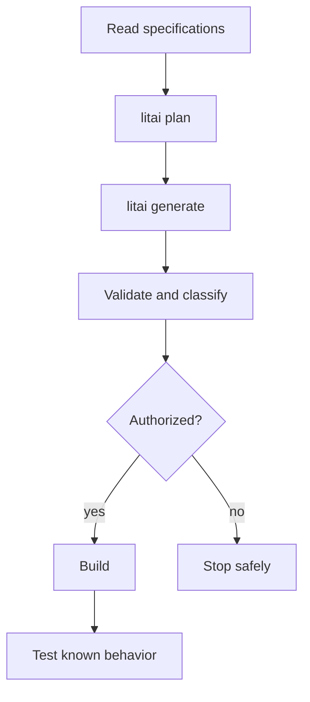

# Framework flow

[Project guide](../README.md) → framework flow

Specifications define behavior; selected Flavors add target requirements; exact skills
guide conversion; workflows and routing constrain model work. Generated source is
disposable and lives beneath the project's generated cache or an isolated runtime.
The project's `+make` selection is a removable target preference: explicit
specification requirements and selected Flavors take precedence, and `-make`
removes it before prompt assembly.

Use the [project map](project-layout.md) to change the owning artifact, and read
[security](security.md) before compiling or running generated code.
